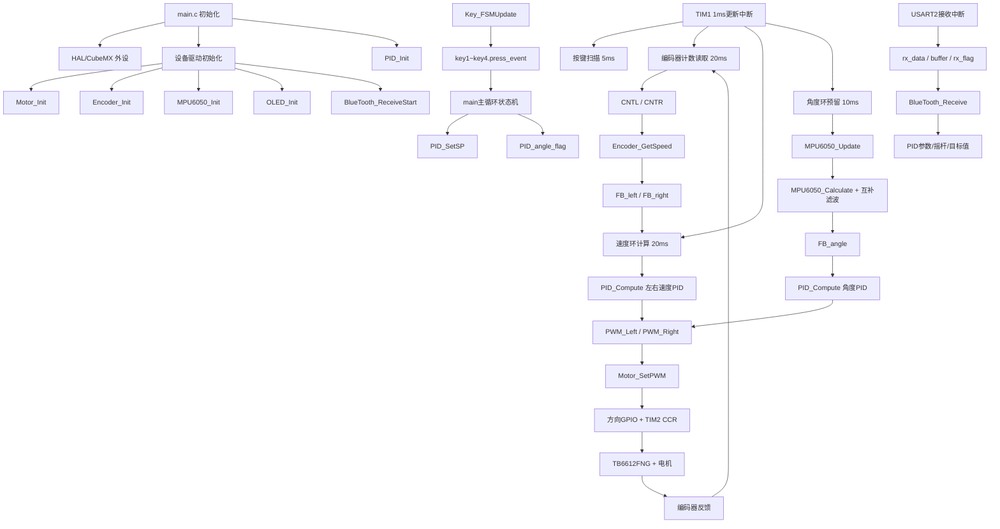
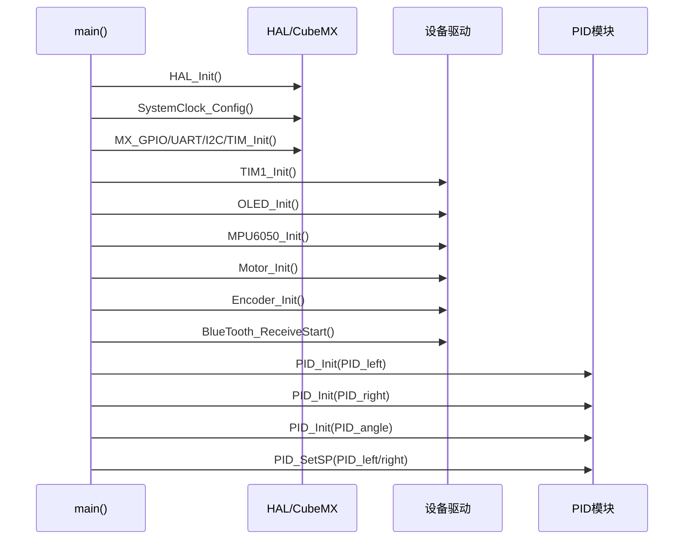
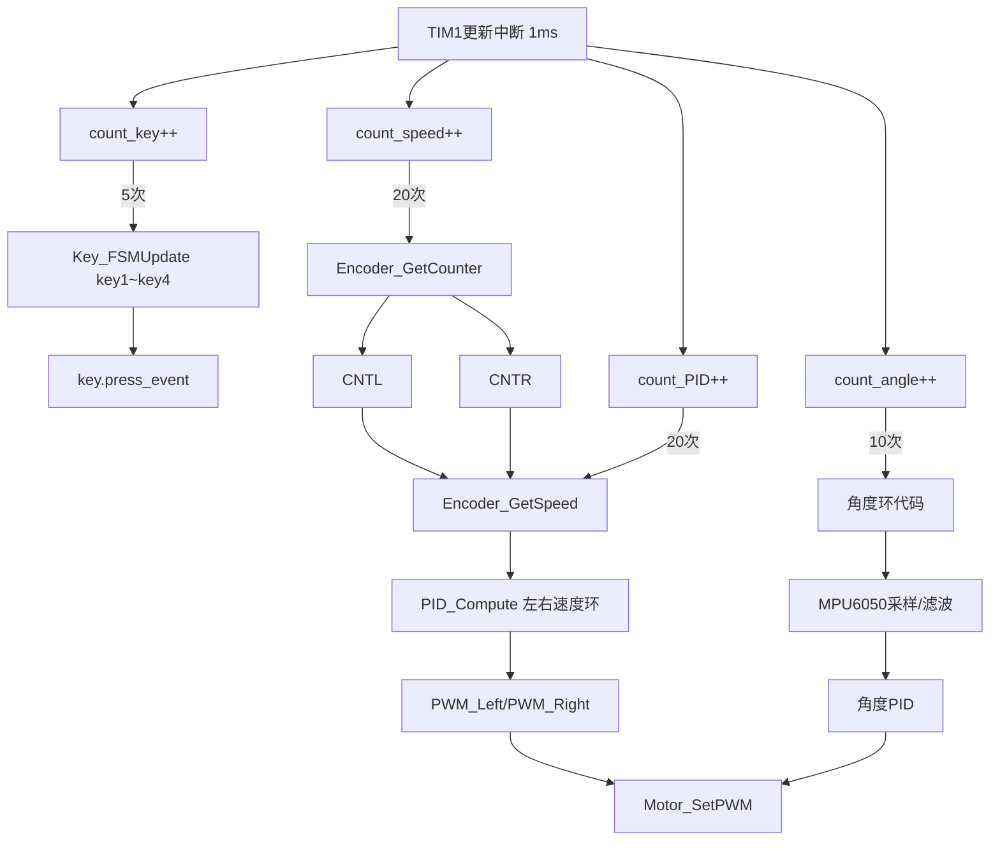
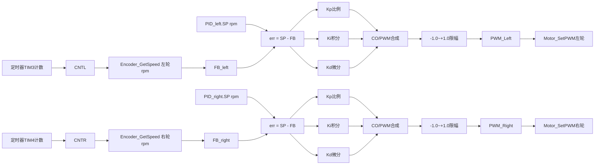
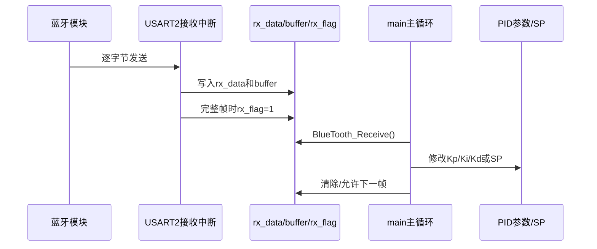
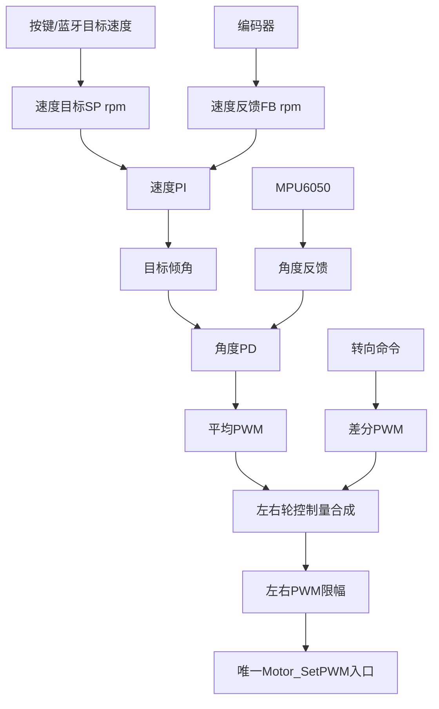

# 平衡车项目结构与变量数据流

> 本文档根据当前工程源码整理，重点描述模块、函数、全局变量及其读写方向。
> 约定：`R` 表示读取，`W` 表示修改/写入，`RW` 表示读写。

## 1. 总体组织图



## 2. 当前程序的运行时序

### 2.1 初始化流程



### 2.2 TIM1 中断流程



## 3. 模块组织

```text
Project_BalanceCar
├─ Core
│  ├─ Src/main.c                 应用入口、全局变量、主循环
│  ├─ Src/stm32f1xx_it.c         TIM1/USART2中断、周期任务
│  ├─ Src/tim.c                  TIM1/TIM2/TIM3/TIM4配置
│  ├─ Src/usart.c                USART1调试、USART2蓝牙
│  ├─ Src/i2c.c                  I2C1 OLED、I2C2 MPU6050
│  └─ Src/gpio.c                 电机方向、按键、LED GPIO
├─ HardWare
│  ├─ Motor                     PWM输出、方向控制
│  ├─ Encoder                   编码器计数和rpm计算
│  ├─ MPU6050                   原始数据、单位换算、角度滤波
│  ├─ Key                       按键状态机和按键事件
│  ├─ OLED                      显示驱动
│  └─ BlueTooth                 蓝牙接收和命令处理
└─ System
   └─ PID_Control               PID参数、状态和计算
```

## 4. 全局变量分类

### 4.1 系统节拍和按键

| 变量 | 类型 | 所在模块 | 写入者 | 读取者 | 作用 |
|---|---|---|---|---|---|
| `counter` | `volatile uint32_t` | `main.c` | 当前无明显使用/旧逻辑 | 旧逻辑 | TIM1计数遗留变量 |
| `key1`~`key4` | `volatile KeyControl` | `main.c` | `Key_FSMUpdate` | `main`状态机、速度环 | 按键状态和一次性按下事件 |
| `press_event` | 成员 | `Key_FSMUpdate` | `Key_FSMUpdate` | `main` | 稳定按下后产生一次事件 |
| `keystate` | 若仍存在 | Motor/旧代码 | 旧按键逻辑 | 旧电机函数 | 旧版按键控制，当前应避免继续使用 |

### 4.2 电机、编码器和速度

| 变量 | 类型 | 写入者 | 读取者 | 作用 |
|---|---|---|---|---|
| `CNTL` | `int16_t` | TIM1中断中的`Encoder_GetCounter` | `Encoder_GetSpeed` | 左轮20ms编码器增量 |
| `CNTR` | `int16_t` | TIM1中断中的`Encoder_GetCounter` | `Encoder_GetSpeed` | 右轮20ms编码器增量 |
| `SpeedL` | `float` | `main`显示任务 | OLED/调试 | 左轮显示速度 |
| `SpeedR` | `float` | `main`显示任务 | OLED/调试 | 右轮显示速度 |
| `FB_left` | `volatile float` | 速度环回调 | `PID_Compute`/显示 | 左轮rpm反馈 |
| `FB_right` | `volatile float` | 速度环回调 | `PID_Compute`/显示 | 右轮rpm反馈 |
| `PWM_Left` | `float` | 速度环回调 | `Motor_SetPWM` | 左轮有符号占空比 |
| `PWM_Right` | `float` | 速度环回调 | `Motor_SetPWM` | 右轮有符号占空比 |

### 4.3 MPU6050和角度

| 变量 | 类型 | 写入者 | 读取者 | 作用 |
|---|---|---|---|---|
| `data_t` | `MPU6050_Data_t` | `MPU6050_Update` | `MPU6050_Calculate` | 原始加速度/陀螺仪数据 |
| `data_f` | `MPU6050_Data_f` | `MPU6050_Calculate` | 角度滤波函数 | 物理单位数据 |
| `data_euler` | `MPU6050_Euler` | 互补滤波函数 | `main`、角度环 | roll/pitch/yaw |
| `FB_angle` | `volatile float` | 角度环 | OLED/PID | 角度反馈 |
| `CCR_AVG` | `volatile float` | 角度环旧逻辑 | 电机输出旧逻辑 | 平均控制量 |
| `CCR_DIFF` | `volatile float` | 当前基本未修改 | 角度环旧逻辑 | 左右差分量 |
| `PID_angle_flag` | `volatile uint8_t` | `main`按键状态机 | 角度环 | 是否启用角度环 |

### 4.4 PID对象

| 变量 | 类型 | 写入者 | 读取者 | 作用 |
|---|---|---|---|---|
| `PID_left` | `PID_Base_variables` | `PID_Init`、`PID_SetSP`、蓝牙参数处理 | `PID_Compute` | 左轮速度环参数和SP |
| `PID_right` | `PID_Base_variables` | `PID_Init`、`PID_SetSP`、蓝牙参数处理 | `PID_Compute` | 右轮速度环参数和SP |
| `PID_angle` | `PID_Base_variables` | `PID_Init`、`PID_SetSP`、蓝牙参数处理 | 角度PID | 角度环参数和SP |
| `PID_Compute_left` | `PID_Compute_variables` | `PID_Compute`、停止逻辑 | `PID_Compute` | 左轮PID历史状态 |
| `PID_Compute_right` | `PID_Compute_variables` | `PID_Compute`、停止逻辑 | `PID_Compute` | 右轮PID历史状态 |
| `PID_Compute_angle` | `PID_Compute_variables` | `PID_Compute`、停止逻辑 | `PID_Compute` | 角度PID历史状态 |

## 5. PID速度环数据流



当前速度环的单位应保持：

```text
SP   = rpm
FB   = rpm
err  = rpm
CO   = 有符号PWM，占空比 -1.0~+1.0
CCR  = Motor_SetPWM内部根据PWM换算得到的定时器比较值
```

## 6. 电机输出数据流

```mermaid
flowchart TD
    U[有符号PWM -1.0~+1.0] --> SIGN{PWM符号}
    SIGN -->|正| DIR1[设置该电机正方向GPIO]
    SIGN -->|负| DIR2[设置该电机反方向GPIO]
    SIGN --> ABS[取绝对值]
    ABS --> SCALE[abs(PWM) × MOTOR_CCR_MAX]
    SCALE --> CCR[TIM2 CCR1/CCR2]
    DIR1 --> TB[TB6612FNG]
    DIR2 --> TB
    CCR --> TB
    TB --> M[电机]
```

当前 `MOTOR_CCR_MAX=3599`，对应 TIM2 `ARR=3599`。

## 7. 蓝牙数据流



## 8. 当前读写关系总表

| 数据 | 生产者/写入者 | 消费者/读取者 |
|---|---|---|
| `key1.press_event` | `Key_FSMUpdate` | `main`角度状态机、速度环 |
| `CNTL/CNTR` | `Encoder_GetCounter` | `Encoder_GetSpeed` |
| `FB_left/FB_right` | TIM1速度任务 | 左右`PID_Compute` |
| `PWM_Left/PWM_Right` | TIM1速度任务 | `Motor_SetPWM` |
| `data_t` | `MPU6050_Update` | `MPU6050_Calculate` |
| `data_f` | `MPU6050_Calculate` | 互补滤波 |
| `data_euler` | 互补滤波 | `main`、角度环 |
| `FB_angle` | 角度环 | OLED、角度PID |
| `PID_left/right.SP` | `PID_SetSP` | `PID_Compute` |
| `PID_left/right.Kp/Ki/Kd` | `PID_Init`、蓝牙处理 | `PID_Compute` |
| `PID_Compute_left/right` | `PID_Compute` | 下一次`PID_Compute` |
| `PID_angle_flag` | `main` | 角度环 |
| `rx_data/buffer/rx_flag` | USART2回调 | `BlueTooth_Receive` |

## 9. 当前最需要注意的耦合点

### 9.1 按键事件有多个消费者

`key1.press_event` 先在角度状态机中被清零，速度环后面可能就收不到同一个事件。

建议：

```text
Key_FSMUpdate只负责产生事件
main只负责统一读取事件
读取后转换成系统命令
速度环和角度环不要直接竞争同一个press_event
```

### 9.2 电机输出入口应唯一

当前速度环调用：

```c
Motor_SetPWM()
```

角度环也可能调用：

```c
Motor_SetPWM()
```

两个环不能同时直接写电机。最终应由一个控制合成函数统一输出：

```text
速度环 → 目标角度
角度环 → 平均PWM
转向环 → 差分PWM
控制合成 → Motor_SetPWM
```

### 9.3 `data_euler`由中断写、主循环读

当前 `data_euler` 在定时中断更新，主循环同时读取。单个`float`通常可以读写，但整个结构体不是一个原子操作。

建议：

```text
中断完成一帧数据后置 angle_data_ready
主循环只读取已经完成的数据
```

### 9.4 速度反馈是共享全局变量

`CNTL/CNTR`由中断修改，`Encoder_GetSpeed()`读取。当前读取与写入都在同一TIM1回调中，基本一致；如果以后把测速放到不同任务，建议使用快照变量。

### 9.5 PID参数和PID历史状态分开

`PID_Base_variables`保存参数和SP；
`PID_Compute_variables`保存误差、积分、微分和时间。

这种分离是合理的，但停止/启动时应通过统一的`PID_ResetState()`清除历史状态，不要在业务代码中逐个成员清零。

## 10. 推荐的最终控制组织



推荐的职责：

```text
MPU6050驱动：只负责读原始数据和校准
角度滤波：只负责生成角度
Encoder驱动：只负责计数和rpm
PID模块：只负责控制量计算
Motor驱动：只负责PWM和方向GPIO
控制器：负责速度环、角度环、转向合成
main：负责状态机、按键、显示和通信
```

